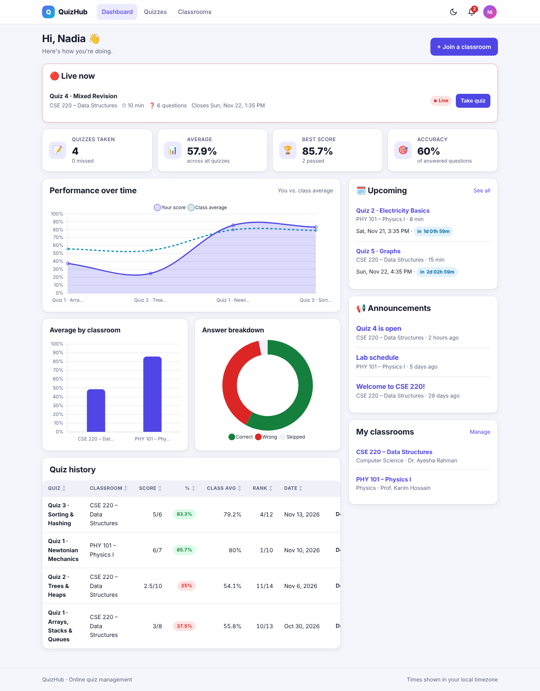
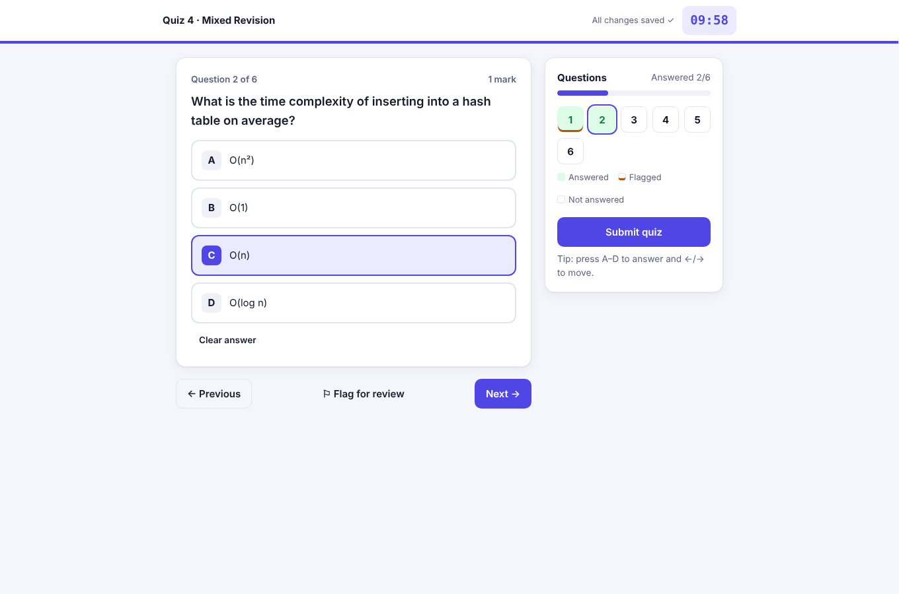
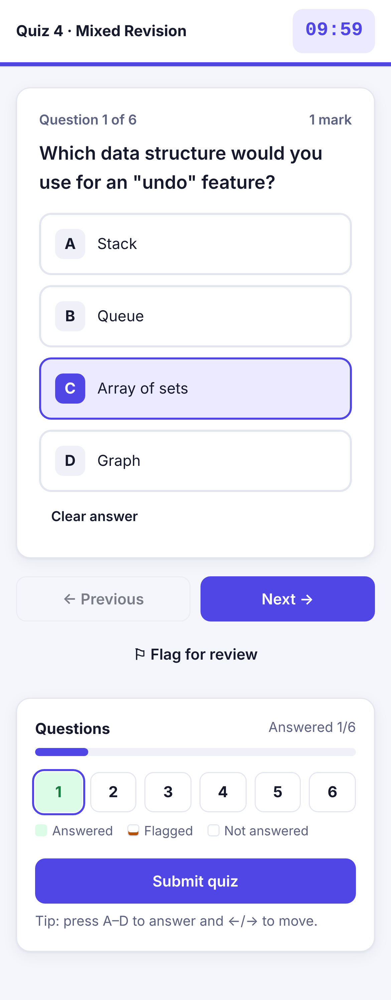
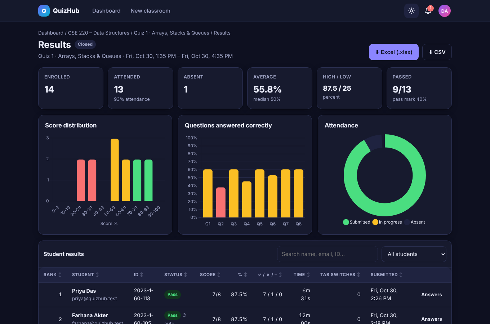

# QuizHub: Online Quiz Management System

QuizHub is a web app for running timed multiple-choice quizzes in a classroom.

- **Faculty** create classrooms, write or import MCQ questions, schedule quizzes and download results as an Excel sheet.
- **Students** join classrooms with a code, take quizzes against a countdown timer and track their progress on a dashboard.

It runs entirely on your own computer (`localhost`). The database is a single SQLite file, so there is no database server to install, and it works on phones as well as desktops.



| Taking a quiz | On a phone | Faculty results (dark mode) |
|---|---|---|
|  |  |  |

---

## Features

### For students
- **Register and sign in** as a student. You can add an optional student ID, which appears in faculty spreadsheets.
- **Join classrooms** with a 6-character code from your teacher.
- **Choose a quiz** from tabs: *Live*, *Upcoming* (with a countdown to opening time), *Completed* and *Missed*.
- **Countdown timer** that starts when you press *Start*. The server keeps the time, so refreshing or changing the device clock doesn't add time. When it reaches zero, your answers are submitted automatically.
- **Autosave and resume.** Every answer is saved as you click it. If the browser closes, you continue where you left off, with the timer still running.
- **Moving around the quiz:** one question at a time, a question palette, flag-for-review, *Clear answer*, and keyboard shortcuts (A–F to answer, ←/→ to move).
- **Performance dashboard:**
  - score over time compared with the class average
  - average by classroom
  - correct/wrong/skipped breakdown
  - accuracy, best score and rank for each quiz
- **Answer review with explanations.** Your teacher decides whether it appears right after you submit, after the quiz closes, or never.
- **Leaderboards** for each quiz and each classroom (the teacher can turn them off).
- **Announcements and a notification bell** for new quizzes, schedule changes, results and posts from your teacher.

### For faculty
- **Classrooms** with join codes. You can regenerate the code, remove students and post announcements.
- **MCQ quiz builder**:
  - 2–6 options per question, exactly one correct answer
  - marks per question and an optional explanation
  - reorder, edit or delete questions, and duplicate a whole quiz
- **CSV import** for adding many questions at once. A template can be downloaded from the quiz page.
- **Scheduling.** Set the opening time, closing time and time limit. Students are notified when you publish or reschedule a quiz.
- **Scoring rules:**
  - optional negative marking (−25/33/50/100% of a question's marks)
  - a pass mark
  - an answer-review policy
- **Anti-cheating:**
  - question and option order shuffled for each student
  - tab switches logged for each student
  - copying and right-click disabled on the quiz page
  - questions lock once anyone has started
- **Results page:**
  - enrolled, attended, absent and pass counts
  - average, median, highest and lowest scores
  - charts of the score distribution and attendance
  - a sortable, searchable table for each student (score, time taken, tab switches)
  - **question analysis** showing how many students picked each option
  - each student's full answer sheet
- **Download results as an Excel file (.xlsx)** with three sheets (*Summary*, *Student results*, *Question analysis*), or as **CSV**.
- **Close now.** End a live quiz early; anyone still working is submitted automatically.

### General
- Mobile-first, responsive layout with a light/dark theme toggle (remembered per browser).
- Times are shown in each viewer's own timezone.
- Security:
  - passwords hashed with bcrypt
  - CSRF tokens on every form and API call
  - HTTP-only session cookies
  - rate-limited sign-in
  - Helmet security headers with a strict Content-Security-Policy
  - every classroom, quiz and attempt checked for ownership
- Works offline: Chart.js is served locally and no CDN is needed.

---

## Quick start

**Requirements:** [Node.js](https://nodejs.org/) 20 or newer (22 LTS recommended).

```bash
git clone https://github.com/Tanzim2001/quiz-management-system.git
cd quiz-management-system
npm install
npm run seed      # optional: loads demo classrooms, quizzes and results
npm start
```

Open **http://localhost:3000**.

### Demo accounts (after `npm run seed`)

| Role    | Email                  | Password      |
|---------|------------------------|---------------|
| Faculty | `faculty@quizhub.test` | `password123` |
| Student | `student@quizhub.test` | `password123` |

The seed also creates 13 more students (`rafi@quizhub.test`, `sadia@quizhub.test`, …), all with the password `password123`. It also creates:
- two classrooms
- closed quizzes with realistic results
- a quiz that is **live right now** for the demo student to take
- upcoming quizzes and a draft

### Scripts

| Command         | What it does |
|-----------------|--------------|
| `npm start`     | Start the server |
| `npm run dev`   | Start with auto-restart on file changes |
| `npm run seed`  | Add demo data (only if the database is empty) |
| `npm run reset` | **Delete the database** and re-seed demo data |
| `npm test`      | Run the end-to-end test suite (uses a temporary database) |

### Try it on your phone
Start the server with `HOST=0.0.0.0 npm start`, then on a phone connected to the same Wi-Fi open `http://<your-computer's-LAN-IP>:3000`.

---

## Configuration

Settings are read from environment variables or from an optional `.env` file (see [`.env.example`](.env.example)). None of them are required.

| Variable              | Default              | Purpose |
|-----------------------|----------------------|---------|
| `PORT`                | `3000`               | HTTP port |
| `HOST`                | `localhost`          | Interface to listen on (`0.0.0.0` for LAN access) |
| `DATA_DIR`            | `./data`             | Folder for the database and the generated session secret |
| `DB_PATH`             | `data/quizhub.db`    | SQLite database file |
| `SESSION_SECRET`      | auto-generated       | Signs session cookies; if unset, one is created in `data/.session-secret` |
| `FACULTY_INVITE_CODE` | *(none)*             | If set, faculty must enter this code to register |
| `NODE_ENV`            | *(none)*             | `production` enables static-file caching |

---

## How it works

```
src/
  server.js            starts HTTP server + auto-submit sweeper (every 15 s)
  app.js               Express app: security headers, sessions, CSRF, routes
  config.js            env/.env configuration
  db.js                SQLite schema (better-sqlite3)
  lib/
    quizService.js     attempts, shuffling, autosave, scoring, auto-submit, analytics, leaderboards
    exporter.js        Excel (.xlsx) and CSV result exports
    sessionStore.js    express-session store on SQLite
    notify.js          in-app notifications
  routes/
    auth.js            landing, register, login, logout
    student.js         dashboard, classrooms, quizzes, attempts, results
    faculty.js         dashboard, classrooms, quiz builder, CSV import, results, exports
    common.js          notifications, account settings
views/                 EJS templates (server-rendered pages)
public/                CSS and browser JS (timer, autosave, charts, editor)
scripts/seed.js        demo data
test/app.test.js       end-to-end tests (node:test + supertest)
```

**Timer integrity.**
- When a student starts, the server stores `deadline = min(start + time limit, quiz close time)`.
- The browser only displays the countdown, corrected for clock drift using the server's time.
- Answers arriving after the deadline (plus a 5-second network grace period) are rejected.
- Attempts whose deadline has passed are scored and marked *auto-submitted*, even if the student never comes back.

**Data model.** The tables are `users`, `classrooms`, `enrollments`, `quizzes`, `questions`, `options`, `attempts` and `answers`, plus `announcements`, `notifications` and `sessions`. Each student gets one attempt per quiz.

### CSV import format

```csv
question,option_a,option_b,option_c,option_d,correct,marks,explanation
"What is 2 + 2?",3,4,5,22,B,1,"2 + 2 = 4"
```

- Up to six options are allowed (`option_a` … `option_f`).
- `correct` is the letter (A–F) or the exact text of the right option.
- `marks` and `explanation` are optional.
- If any row is invalid, nothing is imported, and the page lists the problem rows.

---

## Tech stack

- Node.js and Express 5
- SQLite via better-sqlite3
- EJS server-rendered pages
- Vanilla JavaScript
- Chart.js for charts
- ExcelJS for spreadsheet exports
- bcryptjs and Helmet for security
- express-session for sessions

## License

MIT
